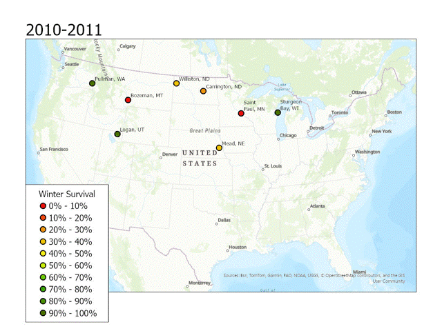
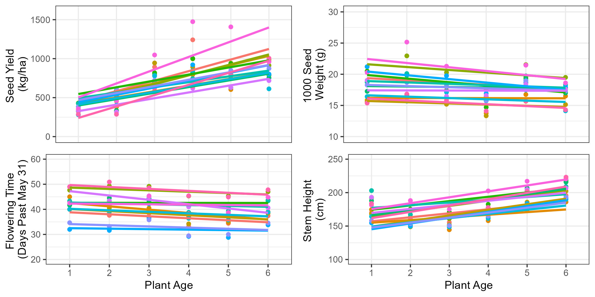

# About Me

Wecome to my website! My name is Sydney Schiffner and I'm currently working as a researcher in the Smith Lab at the University of Minnesota managing a breeding program for a perennial oilseed called silflower (*Silphium integrifolium* Michx). In my free time I'm also pursuing a PhD in Applied Plant Sciences on the Agronomy/Agroecology track, where we're attempting to determine optimal winter survival conditions for the winter annual plant, winter barley (*Hordeum vulgare*). To learn more skills in analysis and data science I'm also in the professional Master's of Geographic Information Sciences program (MGIS). While being a part of the MGIS program I've been able to perform mapping projects examining agricultural and weather data pertaining to the survivability of the system I'm studying for my PhD. Please see my work below, and if you have any inquiries, feel free to contact me ([schif097@umn.edu](mailto:schif097@umn.edu)).

---

# Past GIS Projects
<link rel="stylesheet" href="style.css">

  <article class="card">
    
    

      <h2 class="card-title">WMBT Barley Survival Averages</h2>
      

        Using RStudio and ArcGIS Pro, data was averaged for Winter Malting Barley Trial (WMBT) survival from 2011 through 2024 and averages were calculated. These averages were then plotted at the field station locations along with the number of site-years recorded for the trial. 
      

      <a href="https://smithlab.cfans.umn.edu/barley/winter-malting-barley-trial" class="card-button">Learn More</a>
    

  </article>

  <article class="card">
    
    

      <h2 class="card-title">Winter Malting Barley Trial Survival 2011 through 2025</h2>
      

        Using RStudio, ArcGIS Pro and data obtained from T3 Database for the WMBT trial, multiple years of survival data were made into individual maps, and then made into a gif file that cycles through each individual year of survival.
      

      <a href="https://smithlab.cfans.umn.edu/barley/winter-malting-barley-trial" class="card-button">Learn More</a>
    

  </article>

  <article class="card">
    
    

      <h2 class="card-title">Winter Barley versus Spring Barley Yield Difference</h2>
      

        Using RStudio, ArcGIS Pro, data obtained from T3 Database from WMBT trial, and data obtained from the USDA-NASS API for barley yields across US. Differences between winter barley and spring barley yields were calculated and then plotted on a map.  
      

      <a href="https://smithlab.cfans.umn.edu/barley/winter-malting-barley-trial" class="card-button">Learn More</a>
    

  </article>
  
   <article class="card">
    
    

      <h2 class="card-title">Winter Barley versus Spring Barley Yield Difference - Individual Years</h2>
      

        Using RStudio, ArcGIS Pro and data obtained from T3 Database from WMBT trial, yield differences were calculated (winter barley - spring barley) across individual years and multiple sites in the United States to see yield differences from year to year.
      

      <a href="https://smithlab.cfans.umn.edu/barley/winter-malting-barley-trial" class="card-button">Learn More</a>
    

  </article>

  <article class="card">
    
    

      <h2 class="card-title">Calculating NDVI values for Spring and Fall and Snow Cover to Examine Trends in Winter Survival</h2>
      

        Using Python, ArcGIS Pro, and satellite imagery obtained from Google and PlanetLabs. First examined NDVI values for fall establishment and spring regrowth. Then used compilation of imagery taken during the winter to map snow cover on field over time to visualize snow cover trends.  
      

    

  </article>
  
   <article class="card">
    
    

      <h2 class="card-title">NOAA Weather Station Toolbox</h2>
      

        Using Python, and NOAA weather station API, a toolbox was created where users can input a target location's latitude and longitude, and years of interest. Toolbox will output shapefile summarizing available NOAA data, how distant it is from the initial target point and a csv file with the points information.
      

      <a href="https://www.ncei.noaa.gov/products/land-based-station/global-historical-climatology-network-daily" class="card-button">Learn More</a>
    

  </article>

---
# Current Research Projects
Include pictures and descriptions of projects
1. Breeding perennial oilseed Silphium integrifolium (Silflower) for use as forage and/or oilseed - picture of silflower
2. Examining the interaction effect of age and environment on silflower growth and development - graph of change over time
3. Determining winter survival conditions for winter barley - picture of soil sensors
4. Testing existing crop models (DSSAT) to evaluate prediction power for winter barley height, flowering date and resulting grain yield - picture of winter barley

  <article class="card">
    
    

      <h2 class="card-title">Breeding Perennial Oilseed *Silphium integrifolium* Michx (Silflower) for Use in Agricultural Systems</h2>
      

        As a technician in the Smith Lab I manage the research plots and breeding program of the potential perennial oilseed Silflower. It is currently being researched as a potential oilseed and/or forage crop. Our goals are to domesticate the plant to incorporate it into agricultural systems.
      

      <a href="https://smithlab.cfans.umn.edu/silflower-overview" class="card-button">Learn More</a>
    

  </article>

  <article class="card">
    
    

      <h2 class="card-title">Change In Yield Responses Over Time with Age</h2>
      

        Analyzing how yield and physiological traits change over time as silflower plants age. We're also seeing how different families respond to aging over time.
      

      <a href="https://smithlab.cfans.umn.edu/silflower-overview" class="card-button">Learn More</a>
    

  </article>

  <article class="card">
    
    

      <h2 class="card-title">Alpine Exploration</h2>
      

        Discover high-altitude hiking trails, crisp mountain air, and breathtaking summit views.
      

      <a href="#" class="card-button">Learn More</a>
    

  </article>

  <article class="card">
    
    

      <h2 class="card-title">Coastal Retreat</h2>
      

        Relax by the ocean with quiet beaches, gentle waves, and vibrant sunset vistas.
      

      <a href="#" class="card-button">Learn More</a>
    

  </article>

---
# Resume

---
# Relevant Coursework

---

# Photos in the field!

---

# Shameless Self Promotion
- Include LinkedIn, links to profiles on MGIS site and APG site, smith lab site

