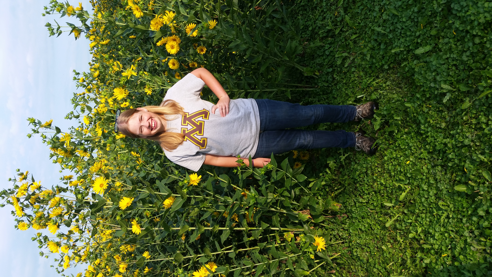

# About Me - Include professional picture

Hi! My name is Sydney Schiffner and I'm currently working as a researcher in the Smith Lab at the University of Minnesota managing a breeding program for a perennial oilseed called silflower (*Silphium integrifolium* Michx). In my free time I'm also pursuing a PhD in Applied Plant Sciences on the Agronomy/Agroecology track, where we're attempting to determine optimal winter survival conditions for the winter annual plant, winter barley (*Hordeum vulgare*). To learn more skills in analysis and data science I'm also in the professional Master's of Geographic Information Sciences program (MGIS). While being a part of the MGIS program I've been able to perform mapping projects examining agricultural and weather data pertaining to the survivability of the system I'm studying for my PhD. Please see my work below, and if you have any inquiries, feel free to contact me ([schif097@umn.edu](mailto:schif097@umn.edu)).

# Past GIS Projects
Include pictures and descriptions of projects
1. Oat yields in MN from USDA-NASS QuickStats data
2. Locations of WMBT sites across the US with survivability
3. Individual years of WMBT Survival (gif with composite map)
4. Yield of winter barley across US using state data from USDA-NASS Quickstats data
5. Satellite imagery composite of snow cover on field reflecting barley survival?
<link rel="stylesheet" href="style.css">

  <article class="card">
    
    

      <h2 class="card-title">USDA NASS Barley Yields</h2>
      

        Using RStudio, ArcGIS Pro and USDA-NASS QuickStats API, data was averaged for barley yields from 2005 through 2025 and then aggregated on a state level and mapped. 
      

      <a href="#" class="card-button">Learn More</a>
    

  </article>

  <article class="card">
    
    

      <h2 class="card-title">Winter Malting Barley Trial Survival</h2>
      

        Using RStudio, ArcGIS Pro and data obtained from T3 Database from WMBT trial, survival data was averaged across years and multiple sites in the United States to examine the distribution of survival trends.
      

      <a href="#" class="card-button">Learn More</a>
    

  </article>

  <article class="card">
    
    

      <h2 class="card-title">Winter Malting Barley Trial Survival</h2>
      

        Using RStudio, ArcGIS Pro and data obtained from T3 Database from WMBT trial, survival data was averaged across years and multiple sites in the United States to examine the distribution of survival trends.
      

      <a href="#" class="card-button">Learn More</a>
    

  </article>

# Current Research Projects
Include pictures and descriptions of projects
1. Breeding perennial oilseed Silphium integrifolium (Silflower) for use as forage and/or oilseed - picture of silflower
2. Examining the interaction effect of age and environment on silflower growth and development - graph of change over time
3. Determining winter survival conditions for winter barley - picture of soil sensors
4. Testing existing crop models (DSSAT) to evaluate prediction power for winter barley height, flowering date and resulting grain yield - picture of winter barley

  <article class="card">
    
    

      <h2 class="card-title">Alpine Exploration</h2>
      

        Discover high-altitude hiking trails, crisp mountain air, and breathtaking summit views.
      

      <a href="#" class="card-button">Learn More</a>
    

  </article>

  <article class="card">
    
    

      <h2 class="card-title">Coastal Retreat</h2>
      

        Relax by the ocean with quiet beaches, gentle waves, and vibrant sunset vistas.
      

      <a href="#" class="card-button">Learn More</a>
    

  </article>

# Resume

# Relevant Coursework

# Photos in the field!

# Shameless Self Promotion
- Include LinkedIn, links to profiles on MGIS site and APG site, smith lab site

